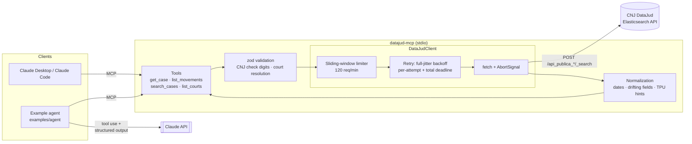
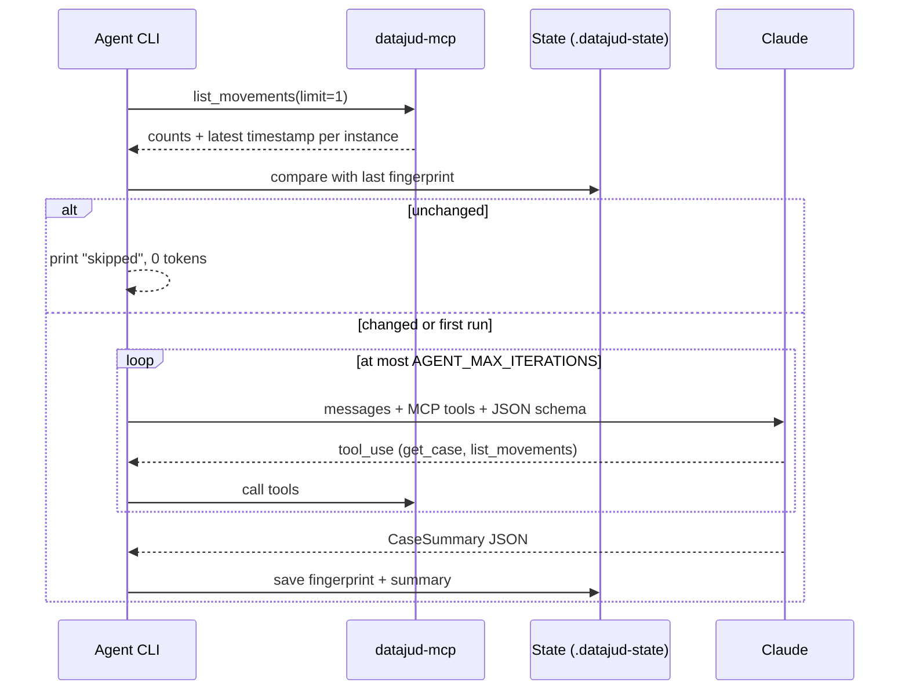

# datajud-mcp

[](https://github.com/JoaoLuizRTelo/datajud-mcp/actions/workflows/ci.yml)


An [MCP](https://modelcontextprotocol.io) server for **DataJud**, the official public API of Brazil's National Council of Justice (CNJ) for court case metadata. It ships with an example **Claude agent** that turns a case number into a structured status report and flags movements a lawyer should look at.

DataJud exposes the public metadata of cases from 91 Brazilian courts through a single Elasticsearch endpoint. The API is slow, loosely documented, and has a few traps that silently return wrong answers. This project wraps it in typed, validated, retry-safe tools that any MCP client (Claude Desktop, Claude Code, your own agent) can use. The agent shows how to build on top of them with production habits: bounded loops, structured outputs, cost gates and offline evals.

<!-- Demo: record with `vhs scripts/demo.tape` and commit docs/demo.gif -->
<!--  -->

## Contents

- [Architecture](#architecture)
- [MCP tools](#mcp-tools)
- [Quickstart](#quickstart)
- [Example agent](#example-agent)
- [Design decisions](#design-decisions)
- [What I learned about the live API](#what-i-learned-about-the-live-api)
- [Testing and evals](#testing-and-evals)
- [Limitations](#limitations)
- [Terms of use](#terms-of-use)

## Architecture



The agent runs a **zero-token pre-check** before involving Claude:



## MCP tools

All tools are read-only, validate their input with zod, declare an `outputSchema`, and return `structuredContent` plus a JSON text fallback. Failures come back as `isError` results whose message says what to do next (e.g. _"check digits are 36 but should be 35"_, _"CNJ rotated the public key, copy the current one from …"_).

| Tool             | Input                                                                                                                         | Output                                                                                                                                                    |
| ---------------- | ----------------------------------------------------------------------------------------------------------------------------- | --------------------------------------------------------------------------------------------------------------------------------------------------------- |
| `get_case`       | `cnjNumber` (formatted or 20 digits, check digits validated), `court?`                                                        | `{ court, cnjNumber, found, records[] }`, one record per instance (first instance, appeal, …) with class, subjects, court unit, dates and latest movement |
| `list_movements` | `cnjNumber`, `court?`, `limit` (1–100, default 20), `since?` (ISO date), `order` (`desc`/`asc`)                               | `{ court, cnjNumber, found, instances[]: { instance, totalMovements, latestMovementAt, movements[] } }`                                                   |
| `search_cases`   | `court`, any of `classCode`, `className`, `subjectCodes[]`, `courtUnitCode`, `filedFrom`, `filedTo`; `size` (1–50), `cursor?` | `{ court, total, results[], nextCursor }`                                                                                                                 |
| `list_courts`    | `segment?` (`superior`, `federal`, `state`, `labor`, `electoral`, `military`)                                                 | `{ courts[]: { alias, name, segment } }`, all 91 indices                                                                                                  |

`court` is optional for case lookups because the court can be derived from the CNJ number (`NNNNNNN-DD.AAAA.J.TR.OOOO`: segment `J`, court `TR`). Each movement carries a `hint` with a plain-English meaning for common codes from CNJ's procedural tables (TPU). DataJud only returns leaf names such as _"Provisório"_ or _"Confirmada"_, which mean nothing without context.

## Quickstart

Requires Node.js 22.12 or newer.

```bash
git clone https://github.com/JoaoLuizRTelo/datajud-mcp.git
cd datajud-mcp
npm install
cp .env.example .env   # then fill in the values below
npm run build
```

| Variable                                                        | Required             | Notes                                                                                                                                                                                                              |
| --------------------------------------------------------------- | -------------------- | ------------------------------------------------------------------------------------------------------------------------------------------------------------------------------------------------------------------ |
| `DATAJUD_API_KEY`                                               | yes                  | CNJ's **public** key, published at [datajud-wiki.cnj.jus.br/api-publica/acesso](https://datajud-wiki.cnj.jus.br/api-publica/acesso). It is not a secret, but CNJ rotates it, so copy the current value from there. |
| `ANTHROPIC_API_KEY`                                             | agent and evals only | Never commit it.                                                                                                                                                                                                   |
| `DATAJUD_TIMEOUT_MS` / `DATAJUD_TOTAL_TIMEOUT_MS`               | no                   | Per attempt (default 90 s) and across retries (default 180 s).                                                                                                                                                     |
| `DATAJUD_MAX_ATTEMPTS` / `DATAJUD_REQUESTS_PER_MINUTE`          | no                   | Defaults 4 and 120 (the cap allowed by the Terms of Use).                                                                                                                                                          |
| `ANTHROPIC_MODEL` / `ANTHROPIC_EFFORT` / `AGENT_MAX_ITERATIONS` | no                   | Defaults `claude-opus-5-5`, `medium`, `6`.                                                                                                                                                                         |

### Run the server

```bash
npm start            # compiled (dist/)
npm run dev          # from source with tsx
```

The server speaks MCP over stdio and logs only to stderr.

### Connect it to Claude Code

```bash
claude mcp add datajud --env DATAJUD_API_KEY=<public key> -- node /absolute/path/to/datajud-mcp/dist/src/index.js
```

DataJud queries often take 20–60 s. Claude Code's default MCP tool timeout is long, but if you set `MCP_TOOL_TIMEOUT` (or a per-server `timeout`), keep it above ~200 s so retries can finish.

### Connect it to Claude Desktop

Add this to `claude_desktop_config.json`. On macOS it's in `~/Library/Application Support/Claude/`, on Windows in `%APPDATA%\Claude\`:

```json
{
  "mcpServers": {
    "datajud": {
      "command": "node",
      "args": ["/absolute/path/to/datajud-mcp/dist/src/index.js"],
      "env": { "DATAJUD_API_KEY": "<public key>" }
    }
  }
}
```

Then ask: _"What's the status of case 0713383-43.2025.8.07.0006?"_

## Example agent

```bash
npm run agent -- 0713383-43.2025.8.07.0006
npm run agent -- 1035289-48.2022.8.26.0602 --court stj   # read the superior court's record
npm run agent -- 0713383-43.2025.8.07.0006 --force       # bypass the pre-check
./scripts/demo.sh                                        # the two-run demo used for the GIF
```

The CLI starts the MCP server as a child process, runs the pre-check, and if anything changed lets Claude call the tools and answer with a schema-constrained `CaseSummary`.

<!-- EXAMPLE_OUTPUT -->

Run it again with nothing new on DataJud and no LLM call is made:

```json
{
  "skipped": true,
  "reason": "No new movements since <time of the last successful run>.",
  "previousSummary": { "...": "the CaseSummary from that run" },
  "tokensSpent": 0
}
```

## Design decisions

**Full-jitter exponential backoff.** A retry waits a random time in `[0, min(20 s, 1 s · 2^attempt)]` ([AWS: "Exponential Backoff and Jitter"](https://aws.amazon.com/blogs/architecture/exponential-backoff-and-jitter/)). DataJud is one shared public cluster; synchronized retries from many clients make overload worse, and jitter spreads them out. `Retry-After` is honored when present. Retried: 429, 5xx, timeouts, network errors, Elasticsearch thread-pool rejections and partial-shard responses. Never retried: 400, 401, 404 and client cancellation.

**Two time limits.** Each HTTP attempt has its own timeout, and the whole search has a total deadline. Without the second one, four slow attempts could stall a tool call for six minutes. The per-attempt timeout is clipped to the time left.

**Sliding-window rate limiter.** The Terms of Use cap usage at 120 requests/minute. A token bucket can burst to 2× that across a window boundary; a sliding window can't.

**Progress heartbeats.** The MCP TypeScript SDK's default request timeout is 60 s, which DataJud regularly exceeds. While a tool waits, the server sends `notifications/progress` every 10 s if the client asked for progress, so clients using `resetTimeoutOnProgress` keep waiting. Cancellation flows the other way: the MCP request's `AbortSignal` aborts the HTTP request.

**Manual agent loop with a max-iterations guard.** The agent owns its loop instead of using the SDK's tool runner. That keeps the failure modes explicit: after `AGENT_MAX_ITERATIONS` model calls it throws `AgentDidNotConvergeError` (exit code 2) with the tool calls it made, and `refusal`, `max_tokens` and `pause_turn` each have a defined outcome. Parallel tool calls run concurrently and are answered in one turn. Tool errors go back to the model as `is_error` results instead of crashing the run.

**Structured output.** The final answer is constrained with `output_config.format` (`betaZodOutputFormat(CaseSummary)`) and re-validated with zod, so callers always get the same shape. The status categories and the attention rule are written into the prompt, which makes them consistent and testable.

**Pre-check before the LLM.** Monitoring is mostly "nothing happened". The CLI fetches movement counts and the latest timestamp per instance through MCP, compares that fingerprint with the last successful run, and skips Claude when nothing changed. State is saved only after a successful summary, so a failed run is retried next time.

**Prompt caching.** The system prompt is static and the date lives in the user message, so tools, system prompt and growing history form a cacheable prefix across loop iterations.

**Lenient in, strict out.** DataJud's live responses drift from its own glossary (string vs number codes, compact vs ISO dates, renamed fields). Raw responses are parsed with permissive zod schemas and normalized into one strict, English-named shape that the tools declare as `outputSchema`.

## What I learned about the live API

I checked each of these against the live API while building, and each is handled in code and covered by a test.

- **ISO dates silently match nothing.** `dataAjuizamento` is stored as `yyyyMMddHHmmss`, although the glossary shows ISO. A range query with `2023-01-01` returns 0 hits with no error, while the same range as `20230101000000` returned 970. `search_cases` takes ISO dates and converts them.
- **HTTP 200 can mean partial data.** Under load DataJud answers `200` with `_shards.failed > 0`. An existing case on a failed shard would look "not found". The client treats this as retryable and never returns partial hits.
- **Queries are slow.** 18–55 s per query is normal and HTTP 504s happen. The retry path recovered from back-to-back 504s during development.
- **One number, several records.** A case can have one document per instance (e.g. `JE` and `TR`), and superior courts keep the _origin_ court's number. So an STJ record is read with `court: "stj"`, not the court derived from the number.
- **No STF.** The Supreme Court isn't in the public API. STF numbers get an explicit error instead of a confusing 404.

## Testing and evals

```bash
npm test        # offline: no network, no API keys
npm run check   # lint + format + typecheck + tests (what CI runs)
npm run evals   # real Claude API, recorded DataJud data
```

- **Unit tests:** CNJ check digits, court resolution for every justice segment, query builders, date normalization, retry/backoff (deterministic random and clock), rate limiter, error mapping, config.
- **Integration tests:** the real MCP server over an in-memory transport, backed by the real HTTP client with scripted responses (503 → 200, 401, 404, timeouts, partial shards), plus a stdio end-to-end test that spawns the server against a local fake DataJud. The agent is tested with a scripted model against the real MCP server: tool bridging, parallel calls, unknown tools, non-convergence, refusals, schema violations and the pre-check skip path.
- **Fixtures:** DataJud responses recorded with `npm run record-fixture` (public metadata only; DataJud has no party data).
- **Evals:** 11 recorded cases covering every status category, multi-instance cases, a superior-court record and a not-found case. Grading is deterministic and touches only structured fields: `found`, `statusCategory`, `needsLawyerAttention` where it is unambiguous, and required movements. Evals run against a fixed "today" so recency rules are reproducible. They are not part of CI because they need a paid API key.

<!-- EVAL_RESULTS -->

## Limitations

- **Not legal advice.** `needsLawyerAttention` is a heuristic over movement codes and dates. DataJud has no deadlines, document text or party data, so the agent cannot know whether a deadline applies to _your_ client.
- **Data freshness.** Courts push data to DataJud on their own schedule; `lastUpdatedAt` is often days or weeks behind the court's own system.
- **Beta API.** CNJ labels the public API as beta, may change it or rotate the public key without notice, and does not guarantee accuracy.
- **Latency.** 20–60 s per call is typical. Interactive clients need a generous tool timeout.
- **TPU hints are partial.** The hint table covers codes seen in real responses, not the full TPU catalog; unknown codes fall back to the Portuguese name.
- **No STF and no free-text search.** Searches filter by codes, class name and dates; the API has no full-text search over decisions.

## Terms of use

This project uses only the official public API with CNJ's published key: no scraping, no undocumented endpoints. The [Terms of Use](https://formularios.cnj.jus.br/wp-content/uploads/2023/11/Termos-de-uso-api-publica-V1.2.pdf) allow non-commercial use only (clauses 3.3 and 3.8) and cap traffic at 120 requests/minute (3.13), which the client enforces. Clause 3.9 asks users to inform CNJ about material derived from the API that is made public. The state files store public case metadata only, no personal data (LGPD, section 4).

## Project structure

```
src/
  index.ts              stdio entrypoint
  server.ts             McpServer + tool registration
  config.ts             env validation
  datajud/              HTTP client, retry, rate limiter, errors, CNJ numbers, courts, queries, schemas, TPU hints
  tools/                one file per MCP tool
examples/agent/         Claude agent: loop, prompts, output schema, pre-check, CLI
evals/                  cases, fixtures, grader, runner
test/                   unit and integration tests
scripts/                fixture recorder, demo script, VHS tape
```

## License

[MIT](LICENSE)
